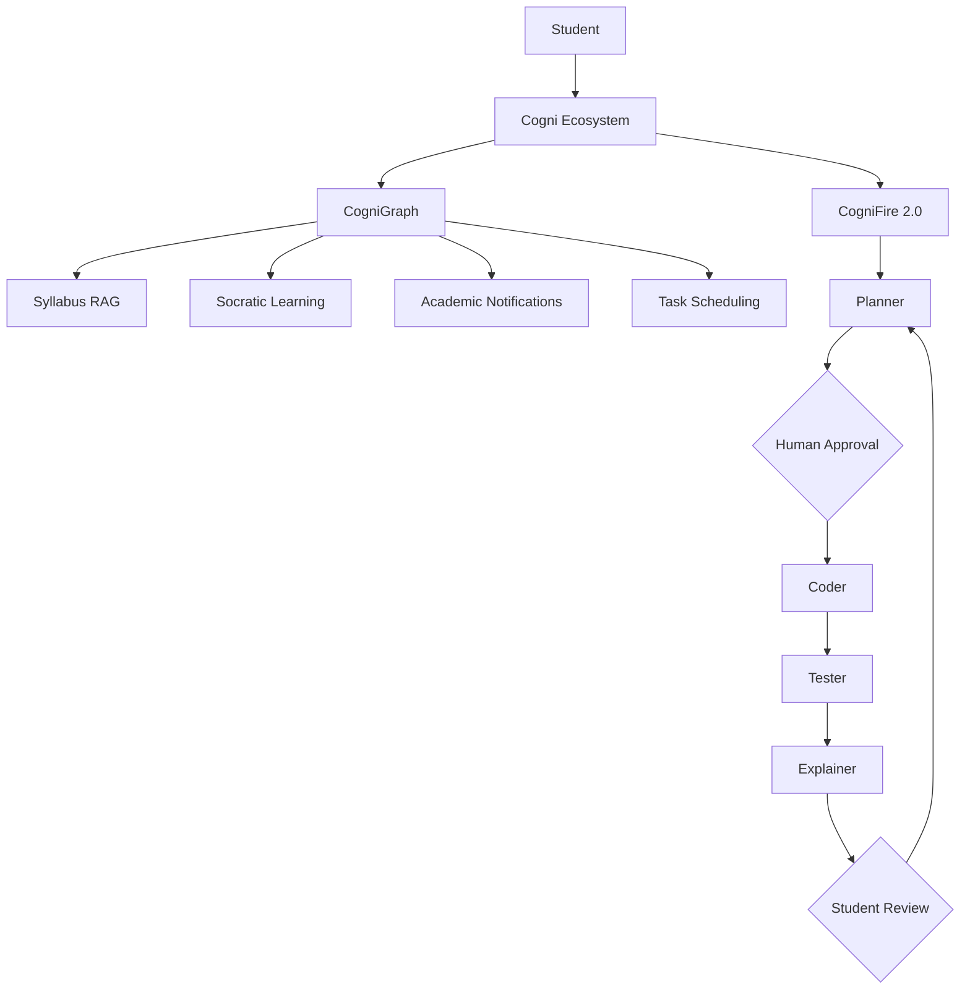

  

<h1 align="center">🧠 Cogni Ecosystem</h1>

  <strong>An Open-Source, Human-in-the-Loop AI Learning Ecosystem for Engineering Students</strong>

  
  
  
  

  <em>Think. Learn. Build. Understand. — AI should make students smarter, not dependent.</em>

---

## 🌟 About the Project

**Cogni Ecosystem** is an open-source, human-in-the-loop AI learning platform designed to address one of the most important challenges in AI-powered education: cognitive offloading.

Conventional digital tools can provide information quickly, but quick information does not always create understanding. Students may copy answers, miss the reasoning behind them, or struggle to connect general explanations with their university syllabus. Cogni is designed to make AI an active learning partner that encourages reasoning, conceptual understanding, and responsible engineering practice.

Initially targeting **Visvesvaraya Technological University (VTU) engineering students**, Cogni combines two interconnected systems:

- 🧠 **CogniGraph:** A personalized, syllabus-grounded AI academic companion.
- 🔥 **CogniFire 2.0:** A transparent, human-supervised multi-agent coding sandbox.

Our vision is to build an educational AI ecosystem where students remain active participants and retain control over AI-assisted decisions.

> 🚧 **Development status:** Cogni Ecosystem is currently in the pre-development planning and architecture phase. The features and workflows described here represent the proposed product direction and are not claims of completed functionality.

## 🎯 The Problem We Want to Solve

Technology has made obtaining answers easier than ever. However, access to answers does not necessarily translate into better learning.

Cogni is designed to address these challenges:

- Students can become dependent on generated answers without understanding them.
- Generic tools often lack university-specific syllabus context.
- Explanations may be delivered without checking whether the student understood them.
- Conventional coding assistance can hide important implementation decisions.
- Academic notifications, deadlines, and learning schedules are scattered across platforms.

Cogni aims to respond through contextual intelligence, adaptive learning, transparent workflows, and explicit human approval.

---

# 🧠 1. CogniGraph — Adaptive Academic Intelligence

CogniGraph is designed to function as a personalized academic companion.

### Student-Aware Learning

The system will first understand the student's academic background, including:

- Name and student profile.
- University and branch.
- Semester and subjects.
- Academic syllabus.
- Learning preferences.

This context will help CogniGraph provide assistance that is relevant to the student's curriculum rather than generic responses.

### Socratic Questioning

Rather than immediately providing solutions, CogniGraph will ask questions to understand the student's thought process and existing knowledge.

Its proposed learning cycle:

1. Understand the student's current knowledge.
2. Ask questions to identify knowledge gaps.
3. Retrieve relevant syllabus material through RAG.
4. Explain concepts in simple, structured language.
5. Ask whether the student understood.
6. Adapt the explanation when the student struggles.
7. Progress when the student demonstrates understanding.

The objective is not merely to produce an answer, but to help the student reach and retain understanding.

### Syllabus-Grounded RAG

CogniGraph is planned to use a retrieval-augmented generation pipeline grounded in VTU academic materials.

The objective is to provide curriculum-relevant explanations while reducing irrelevant, unsupported, or context-free responses.

### Academic Intelligence

CogniGraph is also planned to provide:

- 🔔 Academic notification collection and organization.
- 📅 Intelligent task scheduling and deadline tracking.
- 🎯 Consent-based focus awareness using signals such as rapid tab switching.
- 🔐 Permission-gated external API access.

Privacy, consent, and student control are central requirements for these capabilities.

---

# 🔥 2. CogniFire 2.0 — Human-Supervised Multi-Agent Coding

CogniFire 2.0 aims to transform AI coding from a black-box experience into an explainable engineering workflow.

We are designing a four-agent architecture:

| Agent | Responsibility |
|---|---|
| 🧠 Planner | Analyzes requirements and creates execution plans. |
| 💻 Coder | Implements approved coding tasks. |
| 🧪 Tester | Validates code and identifies issues. |
| 📖 Explainer | Explains code, decisions, and agent activities. |

### Human-in-the-Loop Execution

Every consequential agent action will require explicit student authorization.

Before an action is performed, the student should be able to understand:

- What the system intends to do.
- Why the action is necessary.
- What code or files may be affected.
- What outcome is expected.
- Whether the action should be approved.

The objective is to make AI coding educational, observable, and accountable rather than simply automated.

---

# 🏗️ Proposed Architecture

*This represents the proposed architecture, not a completed implementation.*

---

# ⚙️ Technical Direction

Our current development plan includes:

| Technology | Intended Application |
|---|---|
| Java | Backend engineering |
| Spring AI | AI integration and orchestration |
| LangChain4j | Multi-agent workflows |
| RAG | Academic knowledge retrieval |
| LLM APIs | Reasoning and generation |
| CI/CD | Automated testing and evaluation |

The final stack will be refined as implementation progresses.

---

# 🤖 Why AI Is Required for Cogni Ecosystem

AI is required for Cogni because the project must understand context, adapt explanations, retrieve relevant academic material, and coordinate complex learning and coding workflows. A fixed collection of web pages or static rules cannot provide the same level of personalization and reasoning support.

AI is needed for the following core capabilities:

### Personalized Understanding

Cogni must interpret a student's academic background, current knowledge, questions, mistakes, and learning preferences. AI can use this context to provide guidance that is more relevant than one-size-fits-all content.

### Socratic and Adaptive Learning

CogniGraph requires flexible dialogue. It must ask useful questions, identify knowledge gaps, explain concepts at different levels, and change its approach when a student is confused. This requires language understanding and adaptive reasoning.

### Syllabus-Grounded Knowledge Retrieval

AI can combine retrieval with generation so that explanations are based on the student's syllabus and subject materials while remaining understandable and conversational.

### Transparent Engineering Support

CogniFire 2.0 requires assistance with requirement analysis, planning, implementation, testing, and explanation. AI can help connect these stages, while human approval ensures that consequential actions remain controlled.

### Academic Organization

AI can help classify notifications, extract deadlines, identify priorities, and turn scattered academic information into useful tasks and schedules.

### Responsible Automation

The purpose of AI in Cogni is not to replace student thinking. It is to reduce repetitive work, make complex information easier to understand, and create more time for reasoning, experimentation, and independent learning.

AI is therefore a core requirement of Cogni, but it must always operate within clear boundaries: syllabus grounding, permission controls, transparency, privacy, testing, and human supervision.

---

# 📊 Development Roadmap

The project is currently in its planning and architecture phase. Implementation is scheduled to begin soon.

| Phase | Planned Work |
|---|---|
| 1. Foundation | Repository setup, architecture, and backend foundation |
| 2. CogniGraph | Student onboarding, RAG, and Socratic learning |
| 3. Academic Intelligence | Notifications, scheduling, and focus awareness |
| 4. CogniFire | Planner, Coder, Tester, and Explainer agents |
| 5. Integration | Human approval gates and agent coordination |
| 6. Evaluation | Automated testing, benchmarking, and reliability analysis |
| 7. Release | Documentation and a stable public release |

### Initial Milestones

- [x] Define the project vision.
- [x] Identify the two core components.
- [x] Establish the proposed architecture.
- [x] Define human-in-the-loop principles.
- [ ] Initialize the development repositories.
- [ ] Begin CogniGraph implementation.
- [ ] Begin CogniFire implementation.
- [ ] Integrate and evaluate the components.
- [ ] Publish the first working release.

---

# 🌍 Open-Source Vision

Cogni begins with VTU engineering students, but the long-term vision extends to educational institutions with different syllabi, disciplines, and academic requirements.

The project is intended to become a modular and reusable foundation for responsible AI-assisted education. If successfully developed and validated, Cogni could evolve into an enterprise-grade AI learning platform with institution-specific knowledge, configurable deployments, and controlled integrations.

The initial priority is focused execution: designing, implementing, evaluating, and documenting a reliable foundation before expanding the scope of the project.

---

# 🔒 Our Principles

1. **Human Control:** AI actions remain under student supervision.
2. **Transparency:** The system explains its decisions and activities.
3. **Active Learning:** Understanding matters more than generating answers.
4. **Contextual Accuracy:** Academic responses should be syllabus-grounded.
5. **Privacy:** External access and monitoring require explicit permission.
6. **Responsible Development:** Every feature should be evaluated for educational value and unintended dependence.

---

# 💬 Our Philosophy

> We don't want to build another AI that simply gives students answers.
>
> We want to build an AI that helps students discover answers, understand concepts, develop engineering skills, and become independent thinkers.

  <strong>Cogni Ecosystem — Intelligence that empowers learning, not replaces it.</strong>

---

# 📬 Project Information

- GitHub: [DHANU-MASTER](https://github.com/DHANU-MASTER)
- Repository: [Cogni Ecosystem](https://github.com/DHANU-MASTER/cogni-ecosystem)
- Current stage: Pre-development and architecture
- Primary focus: Responsible AI for engineering education

---

  <strong>An open-source initiative. A student-first vision. A more responsible future for AI in education.</strong>

