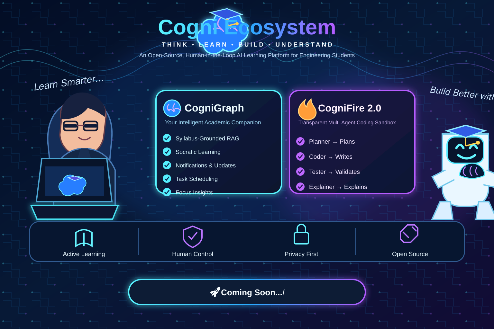
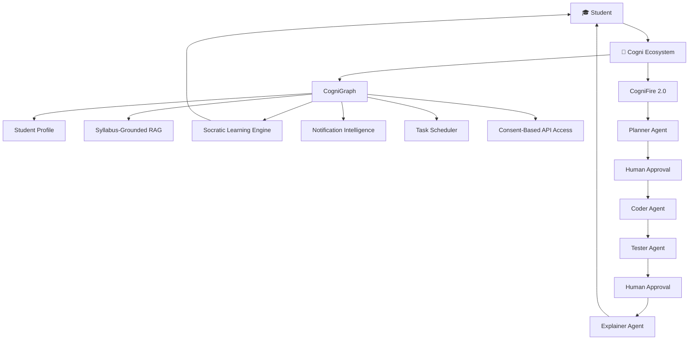

# 🧠 Cogni Ecosystem

### Think. Learn. Build. Understand.

  <strong>An Open-Source, Human-in-the-Loop AI Learning Ecosystem for Engineering Students</strong>

  

  
  
  
  

  <em>AI should make students smarter, not make them dependent on AI.</em>

---

## 🌟 What is Cogni Ecosystem?

**Cogni Ecosystem** is an open-source, human-in-the-loop AI learning platform designed to transform how engineering students learn, understand concepts, and develop software.

Traditional AI chatbots often provide instant answers, encouraging passive learning and cognitive offloading. Cogni takes a different approach: instead of simply giving students answers, it encourages them to think, question, understand, and actively participate.

Initially designed for **Visvesvaraya Technological University (VTU) students**, Cogni combines personalized, syllabus-grounded learning with a transparent multi-agent coding environment.

The ecosystem consists of two major components:

- 🧠 **CogniGraph** – An adaptive AI academic companion.
- 🔥 **CogniFire 2.0** – A transparent, human-supervised multi-agent coding sandbox.

Our mission is simple:

> Build AI that teaches students how to think, rather than thinking on their behalf.

---

# 🧩 The Two Pillars of Cogni

  

## 🧠 1. CogniGraph — Your Intelligent Academic Companion

CogniGraph is more than an AI chatbot. It is a personalized academic intelligence system that understands the student's academic context, learning progress, and knowledge gaps.

### 🎓 Personalized Student Context

CogniGraph begins by understanding the student.

It collects academic information such as:

- Name and basic student profile.
- University and academic institution.
- Branch and semester.
- Subjects and syllabus.
- Academic learning preferences.

This information helps establish a contextual learning environment tailored to the student's academic requirements.

### 💡 Socratic Learning Engine

Instead of immediately generating answers, CogniGraph first asks questions to understand the student's thought process.

Its learning workflow:

1. Understand what the student already knows.
2. Identify knowledge gaps through contextual questions.
3. Retrieve relevant information from the syllabus-grounded RAG pipeline.
4. Explain concepts using simple, structured language.
5. Ask the student whether they understood the explanation.
6. If understood, progress to the next concept.
7. If not, simplify the explanation further using smaller steps and examples.

**The goal is not just to deliver an answer, but to verify understanding.**

### 📚 Syllabus-Grounded RAG Pipeline

CogniGraph uses Retrieval-Augmented Generation (RAG) to provide academically relevant answers.

- Answers are grounded in relevant syllabus materials.
- Contextual retrieval helps reduce irrelevant responses.
- Concepts are explained in student-friendly language.
- Learning follows the student's academic curriculum.

Our initial implementation focuses on VTU academic materials.

### 🔔 Academic Notification Intelligence

CogniGraph also acts as an academic notification assistant.

It aims to help students organize important academic information, including:

- University announcements.
- Academic notifications.
- Assignment updates.
- Examination announcements.
- Important deadlines.

### 📅 Intelligent Task Scheduler

Academic responsibilities can become difficult to manage.

CogniGraph aims to convert academic activities into organized tasks and schedules.

Students can manage:

- Assignment deadlines.
- Examination preparation.
- Study schedules.
- Learning goals.
- Academic reminders.

### 🎯 Consent-Based Focus Awareness

CogniGraph explores focus-awareness through signals such as rapid tab switching.

With explicit student permission, these signals can help identify potential distractions and provide supportive learning interventions.

**Privacy comes first:** monitoring and external data access must remain permission-controlled.

### 🔐 Permission-Gated External Intelligence

CogniGraph prioritizes its local knowledge base.

When external information or API access is necessary, the student is asked for explicit permission before the relevant request is made.

The student remains in control.

---

## 🔥 2. CogniFire 2.0 — Transparent Multi-Agent AI Coding

  

CogniFire 2.0 is a multi-agent AI coding sandbox designed to make AI-assisted software development transparent, explainable, and human-controlled.

Unlike traditional AI coding assistants that perform tasks behind the scenes, CogniFire focuses on making every consequential action understandable to the student.

### 🤖 Meet the Agents

| Agent | Responsibility |
| --- | --- |
| 🧠 Planner | Understands requirements and creates an execution plan. |
| 💻 Coder | Generates and modifies code based on approved instructions. |
| 🧪 Tester | Validates implementations and identifies errors. |
| 📖 Explainer | Explains agent decisions, generated code, and execution steps. |

### 🔄 How CogniFire Works

1. Student submits a coding task.
2. Planner analyzes the requirement.
3. The proposed plan is explained to the student.
4. Student reviews and approves the next consequential action.
5. Coder performs the authorized coding task.
6. Tester evaluates the implementation.
7. Explainer describes what happened and why.
8. Student remains in control throughout the workflow.

### 🛡️ Human-in-the-Loop Architecture

Our central design principle:

**No consequential agent action should happen without explicit human authorization.**

CogniFire aims to provide:

- Transparent agent decisions.
- Explainable execution workflows.
- Permission-gated actions.
- Controlled code modifications.
- Testing and validation.
- Human supervision at every consequential step.

We want students to understand not only the final code but also the engineering process behind it.

---

# 🏗️ System Architecture

The Cogni Ecosystem is designed as a modular architecture with two interconnected AI-powered systems.

*The diagram represents the intended logical architecture; individual modules are being developed and integrated.*

---

# ⚙️ Technology Stack

Cogni is built around a modular, extensible backend architecture.

| Technology | Purpose |
| --- | --- |
| Java | Core backend development |
| Spring AI | AI application integration |
| LangChain4j | LLM orchestration and agent workflows |
| RAG | Syllabus-grounded knowledge retrieval |
| LLM APIs | Reasoning and language generation |
| CI/CD | Automated testing and integration evaluation |

*Additional infrastructure, databases, frontend technologies, and deployment tools will be documented as their implementation is finalized.*

---

# 🚀 Project Roadmap

We believe in building, testing, and improving through continuous development.

- [x] Establish Cogni Ecosystem vision and architecture.
- [x] Define CogniGraph and CogniFire as core components.
- [x] Design human-in-the-loop interaction principles.
- [ ] Implement personalized student onboarding.
- [ ] Integrate VTU syllabus-grounded RAG.
- [ ] Develop Socratic questioning and adaptive explanations.
- [ ] Implement academic notification intelligence.
- [ ] Implement intelligent task scheduling.
- [ ] Develop consent-based focus-awareness.
- [ ] Build Planner, Coder, Tester, and Explainer agents.
- [ ] Integrate permission-gated agent execution.
- [ ] Implement automated testing and CI/CD evaluation.
- [ ] Conduct real-world student testing.
- [ ] Release a stable open-source version.
- [ ] Explore institutional and enterprise deployments.

---

# 🌍 Open Source & Future Vision

Cogni Ecosystem begins with VTU engineering students, but our vision extends beyond a single university.

We are building a modular and reusable framework that can potentially be adapted by:

- Engineering colleges.
- Universities.
- Academic institutions.
- Educational technology developers.
- Open-source contributors.

Our long-term vision is to evolve Cogni into an **enterprise-grade AI learning infrastructure for educational institutions**, with institution-specific syllabi, configurable deployments, academic integrations, and scalable AI learning services.

If successfully validated, Cogni could become a foundation for responsible AI-assisted education across multiple institutions.

---

# 🤝 Contributing

We believe meaningful innovation happens through collaboration.

Developers, students, researchers, and educators are welcome to contribute.

Potential contribution areas include:

- AI agent development.
- RAG pipeline improvements.
- Prompt engineering and evaluation.
- Backend engineering.
- Frontend development.
- Educational content integration.
- Testing and documentation.
- Security and privacy improvements.

### How to Contribute

1. Fork this repository.
2. Create a feature branch.
3. Implement your changes.
4. Add appropriate tests.
5. Submit a pull request with a clear description.

We welcome ideas, suggestions, bug reports, and constructive feedback.

---

# 📸 Screenshots & Demonstrations

We are continuously developing the Cogni interface and workflows.

Add actual application screenshots here as the modules become available.

| CogniGraph | CogniFire 2.0 |
| --- | --- |
| `assets/cognigraph-dashboard.png` | `assets/cognifire-dashboard.png` |
| `assets/cognigraph-learning.png` | `assets/cognifire-agents.png` |

---

# 🔒 Responsible AI Principles

Cogni is built around a few fundamental principles:

1. **Human Control:** Students remain in control of consequential AI actions.
2. **Transparency:** Agents explain what they are doing and why.
3. **Active Learning:** AI encourages reasoning rather than passive answer consumption.
4. **Contextual Accuracy:** Academic answers are grounded in relevant learning materials.
5. **Privacy:** Sensitive monitoring and external access require explicit permission.
6. **Accessibility:** Learning should become easier to understand, not more complicated.

---

# 💬 Our Philosophy

> We don't want to build another AI that gives students answers.
>
> We want to build an AI that helps students discover answers, understand concepts, develop engineering skills, and become independent thinkers.

**Cogni Ecosystem — Intelligence that empowers learning, not replaces it.**

---

# 📬 Connect & Collaborate

Interested in contributing, collaborating, testing, or bringing Cogni to your institution?

We would love to hear from you.

- GitHub: [DHANU-MASTER](https://github.com/DHANU-MASTER)
- Repository: [Cogni Ecosystem](https://github.com/DHANU-MASTER/cogni-ecosystem)
- Contact: [Your Email]

---

<strong>Built with curiosity, engineering, and a vision for better education. ❤️</strong>

⭐ If you believe AI should empower human intelligence, support the project by starring the repository!

