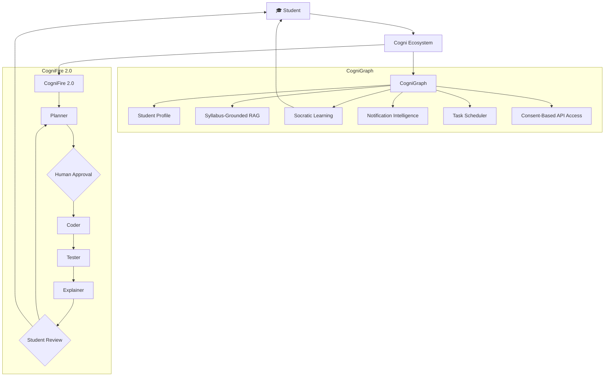

# 🧠 Cogni Ecosystem

### Think. Learn. Build. Understand.

  

  <strong>An Open-Source, Human-in-the-Loop AI Learning Ecosystem for Engineering Students</strong>

  
  
  
  

  <em>AI should make students smarter, not make them dependent on AI.</em>

---

## 🌟 What is Cogni Ecosystem?

**Cogni Ecosystem** is an open-source, human-in-the-loop AI learning platform envisioned to transform how engineering students learn, understand concepts, and develop software.

Traditional AI chatbots often provide instant answers, encouraging passive learning, copy-pasting, and cognitive offloading. Cogni takes a different approach: instead of simply giving students answers, it aims to encourage them to think, question, understand, and actively participate.

Initially targeting **Visvesvaraya Technological University (VTU) engineering students**, Cogni combines personalized, syllabus-grounded learning with a transparent multi-agent coding environment.

The ecosystem consists of two core components:

- 🧠 **CogniGraph** — An adaptive, personalized AI academic companion.
- 🔥 **CogniFire 2.0** — A transparent, human-supervised multi-agent coding sandbox.

Our mission:

> Build AI that teaches students how to think, rather than thinking on their behalf.

<blockquote>
  🚧 <strong>Development Status</strong>

  Cogni Ecosystem is currently in its initial planning and architecture phase. Implementation is scheduled to begin soon. The features, workflows, and architecture described in this repository represent our proposed design and development vision, not a claim of completed functionality.
</blockquote>

---

# 🧩 The Two Pillars of Cogni

## 🧠 1. CogniGraph — Your Intelligent Academic Companion

CogniGraph is envisioned as more than an AI chatbot. It aims to become a personalized academic intelligence system that understands a student's academic context, learning preferences, and knowledge gaps.

### 🎓 Personalized Student Context

CogniGraph will begin by understanding the student before providing academic assistance.

The proposed onboarding process includes:

- Student name and basic profile.
- University and academic institution.
- Branch and semester.
- Subjects and academic syllabus.
- Learning preferences and academic context.

This information will help establish a personalized learning environment tailored to the student's curriculum.

### 💡 Socratic Learning Engine

Instead of immediately generating answers, CogniGraph will first ask questions to understand the student's thought process.

**Proposed learning workflow:**

1. Understand what the student already knows.
2. Ask contextual questions to identify knowledge gaps.
3. Retrieve relevant information from the syllabus-grounded RAG pipeline.
4. Explain concepts using simple and structured language.
5. Ask the student whether they understood the explanation.
6. If understood, progress to the next concept.
7. If not, simplify the explanation further using analogies, examples, and smaller steps.

**The goal is not simply to deliver answers, but to encourage and verify understanding.**

### 📚 Syllabus-Grounded RAG Pipeline

CogniGraph is planned to use Retrieval-Augmented Generation (RAG) to provide academically relevant answers.

Key objectives:

- Ground responses in relevant syllabus materials.
- Retrieve subject-specific information.
- Reduce irrelevant or unsupported answers.
- Explain concepts in student-friendly language.
- Align learning with the student's academic curriculum.

The initial implementation will focus on VTU academic materials, with future possibilities for other universities.

### 🔔 Academic Notification Intelligence

CogniGraph is also envisioned as an academic notification assistant.

It aims to collect, organize, and help students track relevant academic updates, including:

- University announcements.
- Academic notifications.
- Assignment updates.
- Examination announcements.
- Important deadlines.

The goal is to reduce the effort required to track academic information across different sources.

### 📅 Intelligent Task Scheduler

CogniGraph will also aim to function as a personal academic task manager.

Planned capabilities include:

- Assignment deadline tracking.
- Examination preparation schedules.
- Personalized study plans.
- Academic task management.
- Learning goals and reminders.

The objective is to transform scattered academic responsibilities into an organized and manageable workflow.

### 🎯 Consent-Based Focus Awareness

CogniGraph explores focus-awareness through signals such as rapid tab switching.

With explicit student permission, supported activity signals could help identify possible distractions or interruptions during learning sessions.

The intention is to provide supportive learning interventions rather than monitor or punish students.

**Privacy and user control will remain fundamental design principles.**

### 🔐 Permission-Gated External Intelligence

CogniGraph will prioritize its local academic knowledge base.

When external information or API access is necessary, the system will request explicit student permission before making the relevant external request.

The student remains in control of their data and external interactions.

---

## 🔥 2. CogniFire 2.0 — Transparent Multi-Agent AI Coding

CogniFire 2.0 is envisioned as a multi-agent AI coding sandbox designed to make AI-assisted software development transparent, explainable, and human-controlled.

Unlike conventional AI coding assistants that may perform operations behind the scenes, CogniFire aims to explain what it is doing, why it is doing it, and what it intends to do next.

### 🤖 Meet the Four Agents

| Agent | Responsibility |
|---|---|
| 🧠 Planner | Understands requirements and develops an execution plan. |
| 💻 Coder | Generates and modifies code based on approved instructions. |
| 🧪 Tester | Evaluates implementations and identifies errors. |
| 📖 Explainer | Explains agent decisions, generated code, and execution steps. |

### 🔄 Proposed Agent Workflow

1. Student submits a coding task.
2. Planner analyzes the requirement.
3. Planner explains its proposed execution plan.
4. Student reviews and approves the proposed action.
5. Coder performs the authorized coding task.
6. Tester evaluates the implementation.
7. Explainer describes what happened and why.
8. Student reviews the results and decides the next step.

### 🛡️ Human-in-the-Loop Architecture

Our central design principle:

**No consequential agent action should happen without explicit human authorization.**

CogniFire aims to provide:

- Transparent agent decisions.
- Explainable execution workflows.
- Permission-gated agent actions.
- Controlled code modifications.
- Testing and validation.
- Human supervision throughout the workflow.

We want students to understand not only the final code, but also the engineering process behind it.

---

# 🏗️ Proposed System Architecture

The following diagram represents the intended high-level architecture of Cogni Ecosystem. It is a design proposal and will evolve during implementation.

---

# ⚙️ Proposed Technology Stack

The following technologies are part of our current technical direction. Final selections and integrations may evolve during development.

| Technology | Intended Purpose |
|---|---|
| Java | Core backend development |
| Spring AI | AI application integration |
| LangChain4j | LLM orchestration and agent workflows |
| RAG | Syllabus-grounded knowledge retrieval |
| LLM APIs | Reasoning and language generation |
| CI/CD | Automated testing and integration evaluation |

Additional infrastructure, databases, frontend technologies, and deployment tools will be documented as implementation progresses.

---

# 🚀 Development Roadmap

Cogni Ecosystem is currently in its planning and architecture stage. We intend to build incrementally, validate each component, and improve through continuous development.

### Phase 1 — Foundation

- [x] Establish project vision and objectives.
- [x] Define CogniGraph and CogniFire 2.0.
- [x] Establish human-in-the-loop design principles.
- [x] Define the initial technical direction.
- [ ] Initialize project repositories and backend structure.
- [ ] Establish development and contribution guidelines.

### Phase 2 — CogniGraph

- [ ] Implement personalized student onboarding.
- [ ] Integrate VTU syllabus materials.
- [ ] Develop the syllabus-grounded RAG pipeline.
- [ ] Implement Socratic questioning.
- [ ] Develop adaptive explanations.
- [ ] Explore academic notification intelligence.
- [ ] Implement intelligent task scheduling.
- [ ] Develop consent-based focus-awareness.

### Phase 3 — CogniFire 2.0

- [ ] Develop the Planner agent.
- [ ] Develop the Coder agent.
- [ ] Develop the Tester agent.
- [ ] Develop the Explainer agent.
- [ ] Implement agent coordination.
- [ ] Integrate permission-gated execution.
- [ ] Develop transparent execution workflows.

### Phase 4 — Testing and Evaluation

- [ ] Implement automated testing.
- [ ] Establish CI/CD pipelines.
- [ ] Benchmark prompt reliability.
- [ ] Evaluate agent coordination.
- [ ] Test human approval mechanisms.
- [ ] Evaluate RAG accuracy and hallucinations.
- [ ] Optimize performance and API usage.
- [ ] Conduct real-world student testing.

### Phase 5 — Open-Source Release

- [ ] Publish setup and installation documentation.
- [ ] Release the initial stable version.
- [ ] Invite external contributors.
- [ ] Expand academic syllabus support.
- [ ] Explore institutional deployments.

---

# 🌍 Open Source & Future Vision

Cogni Ecosystem begins with VTU engineering students, but our vision extends beyond a single university.

We aim to create a modular and reusable framework that developers and educational institutions can adapt to their own academic requirements.

Potential future adopters include:

- Engineering colleges.
- Universities.
- Academic institutions.
- Educational technology developers.
- Open-source research communities.

### 🏢 Long-Term Institutional Vision

If successfully developed, tested, and validated, Cogni Ecosystem could evolve into an **enterprise-grade AI learning platform for educational institutions**.

Potential future capabilities include:

- Institution-specific syllabus integration.
- Customizable academic deployments.
- University-level integrations.
- Scalable AI learning infrastructure.
- Institutional administration and management.

Our long-term goal is to establish a reusable foundation for responsible AI-assisted education across institutions.

---

# 🤝 Contributing

We believe meaningful innovation happens through collaboration.

Although implementation has not started, we welcome early interest from developers, engineering students, researchers, and educators.

### Areas Where You Can Contribute

- AI agent architecture.
- RAG pipeline development.
- Prompt engineering and evaluation.
- Java and Spring AI backend development.
- LangChain4j integrations.
- Frontend development.
- Academic content integration.
- Testing and documentation.
- Security and privacy engineering.

### How to Get Involved

1. Star the repository.
2. Explore the proposed architecture.
3. Open an issue to discuss suggestions or improvements.
4. Share ideas for new features.
5. Watch the repository for implementation updates.

Contribution instructions will be expanded as the codebase becomes available.

---

# 📸 Screenshots & Demonstrations

**Coming soon!**

Since the project is currently in its planning stage, actual application screenshots and working demonstrations are not yet available.

We will update this section as CogniGraph and CogniFire 2.0 are implemented.

---

# 🔒 Responsible AI Principles

Cogni is being designed around six fundamental principles:

1. **Human Control:** Students retain control over consequential AI actions.
2. **Transparency:** Agents explain what they intend to do and why.
3. **Active Learning:** AI encourages reasoning rather than passive answer consumption.
4. **Contextual Accuracy:** Academic answers are grounded in relevant learning materials.
5. **Privacy:** Monitoring and external access require explicit permission.
6. **Student Empowerment:** AI should strengthen independent thinking rather than replace it.

---

# 💬 Our Philosophy

> We don't want to build another AI that simply gives students answers.
>
> We want to build an AI that helps students discover answers, understand concepts, develop engineering skills, and become independent thinkers.

  <strong>Cogni Ecosystem — Intelligence that empowers learning, not replaces it.</strong>

---

# 📬 Connect & Collaborate

Interested in contributing, collaborating, or helping bring Cogni to your institution?

We would love to hear from you.

- GitHub: [DHANU-MASTER](https://github.com/DHANU-MASTER)
- Repository: [Cogni Ecosystem](https://github.com/DHANU-MASTER/cogni-ecosystem)
- Contact: [Your Email]

---

  <strong>Built with curiosity, engineering, and a vision for better education. ❤️</strong>

  ⭐ If you believe AI should empower human intelligence, star the repository and join us in building the future of AI-powered education!

